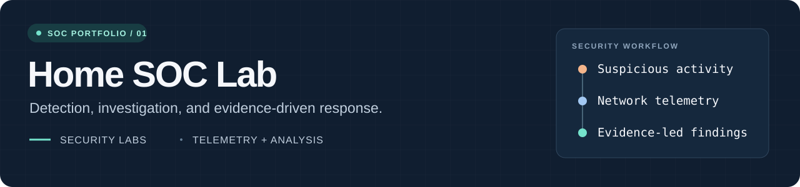
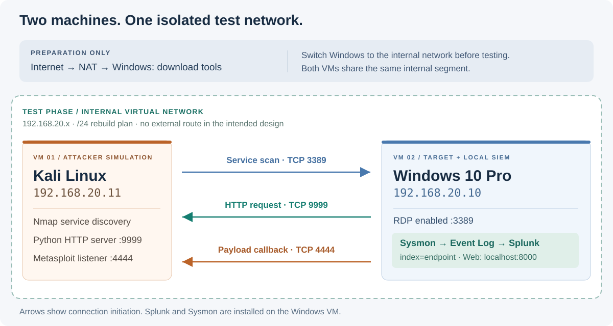

<p align="center">
  
</p>

# Home SOC Lab

**Investigating a disguised executable with Sysmon and Splunk.**

I built this lab to practice the work of a SOC analyst: collecting endpoint telemetry, identifying suspicious activity, and explaining what the evidence supports. Using two virtual machines, I simulated execution of a Windows payload from Kali Linux, verified its outbound connection, and inspected Windows activity in Splunk.

**Stack:** Windows 10 Pro · Kali Linux · VirtualBox · Sysmon · Splunk · Nmap · Metasploit

[Investigation report](analysis/investigation.md) · [Lab walkthrough](walkthrough/attack-simulation.md) · [Splunk searches](detections/README.md) · [Screenshot evidence](screenshots/README.md)

## The case at a glance

| Question | Finding |
| --- | --- |
| What was exposed? | Nmap identified Microsoft Terminal Services on `192.168.20.10:3389`. |
| How did execution happen? | I downloaded and manually ran `Resume.pdf.exe`, an executable with a PDF-like filename. |
| What connection was visible? | `netstat -anob` associated `Resume.pdf.exe`, PID `3604`, with an established connection to `192.168.20.11:4444`. |
| Was remote command execution demonstrated? | A screenshot shows a Meterpreter session opening a Windows command shell. |
| Did telemetry reach Splunk? | `index=endpoint` returned **463 events** in the captured search window, with a Sysmon process-creation event visible. |
| What is the detection focus? | Double-extension executables, unexpected shell children, and process-to-network correlation. |

The demonstrated entry point was **user execution of the downloaded file**. Discovering RDP on port 3389 did not establish that RDP was exploited. The 463-event count describes the whole search window, not 463 malicious events.

## Architecture



| Component | Role | Lab address / access |
| --- | --- | --- |
| Windows 10 **Pro** | Target endpoint; runs Sysmon and Splunk locally | `192.168.20.10` |
| Kali Linux | Attacker simulation; HTTP server and callback listener | `192.168.20.11` |
| Splunk Web | Search interface on the Windows VM | `localhost:8000` on Windows |
| Internal virtual network | Shared segment during testing | `192.168.20.x`; `/24` is the documented rebuild setting |

I used NAT on Windows to download the tools, then switched to an internal network and attached Kali to the same segment. Splunk runs on the target VM, so the lab uses **two VMs**. See [network design](setup/network.md) for the separation between preparation and testing.

Windows 10 Pro was chosen because it can host incoming Remote Desktop connections; Windows 10 Home cannot. Other supported editions also provide this capability. [Microsoft: supported Remote Desktop configurations](https://learn.microsoft.com/en-us/windows-server/remote/remote-desktop-services/remotepc/remote-desktop-supported-config)

## Investigation highlights

### 1. Attribute the connection to a process


The important relationship is **process → remote endpoint**:

```text
Resume.pdf.exe  (PID 3604)
  192.168.20.10:51543  →  192.168.20.11:4444  ESTABLISHED
```

The same output shows Edge communicating with Kali on port `9999`. Separating the browser connection from the executable's callback prevents confusing file delivery with command-and-control traffic. Port 4444 alone would not identify malicious software; the executable name, connection ownership, and remote shell provide the context.

### 2. Confirm telemetry before writing detections


The visible event has provider `Microsoft-Windows-Sysmon`, Event ID `1`, and a `cmd.exe` image. This confirms process telemetry is searchable. It does not, on its own, link that command prompt to the payload. The separate process-table image is a **reference example**, not evidence from this run. The [investigation report](analysis/investigation.md) explains the additional correlation needed.

## What I practiced

- Building an isolated Windows/Kali environment and documenting traffic direction.
- Configuring endpoint visibility with Sysmon and local Splunk ingestion.
- Reading a service scan without treating an open port as proof of compromise.
- Connecting executable identity, process ownership, and network activity.
- Inspecting process-creation telemetry in a SIEM and identifying parent-child pivots for follow-up.
- Writing an evidence-based incident narrative and identifying missing telemetry.

## Explore the lab

| Resource | What it contains |
| --- | --- |
| [Windows setup](setup/windows-vm.md) | Pro edition, Sysmon configuration, local Splunk collection, and validation |
| [Network and Kali setup](setup/network.md) | NAT preparation, internal networking, IP plan, and service roles |
| [Attack simulation](walkthrough/attack-simulation.md) | Recorded sequence with evidence references and command interpretation |
| [Investigation report](analysis/investigation.md) | Findings, lab indicators, ATT&CK mappings, and evidence limits |
| [Detection workbook](detections/README.md) | Four SPL searches, prerequisites, triage guidance, and validation status |
| [Evidence gallery](screenshots/README.md) | Seven lab screenshots, one separate reference example, and a SHA-256 manifest |
| [GitHub publishing](docs/publishing.md) | Suggested description, topics, and publishing commands |

## What I would improve next

- Export the original Sysmon events with `ProcessGuid`, `ParentProcessGuid`, hashes, and UTC timestamps.
- Validate the supplied searches against the live lab and retain their result exports.
- Confirm Event ID 3 collection, then correlate the callback with the same process GUID seen at execution.
- Compare activity with Defender enabled and document the difference in prevention and visibility.
- Move Splunk to a separate collector in a future version so a compromised endpoint does not also host its own evidence store.

## Scope and credits

This was an intentionally vulnerable, isolated training environment. I disabled Defender for the simulation and enabled Remote Desktop as part of the lab setup. These are recorded lab conditions. The repository contains documentation, screenshots, and defensive search examples; executable payloads and VM images are excluded.

The setup history comes from my lab notes and the supplied screenshots. New configuration examples and SPL searches are clearly labeled as rebuild or validation material. No raw event export or live Splunk instance was available while preparing this repository.

Sysmon configuration credit: [Olaf Hartong's sysmon-modular](https://github.com/olafhartong/sysmon-modular). Tool and technique references are linked beside the relevant setup and analysis notes.
