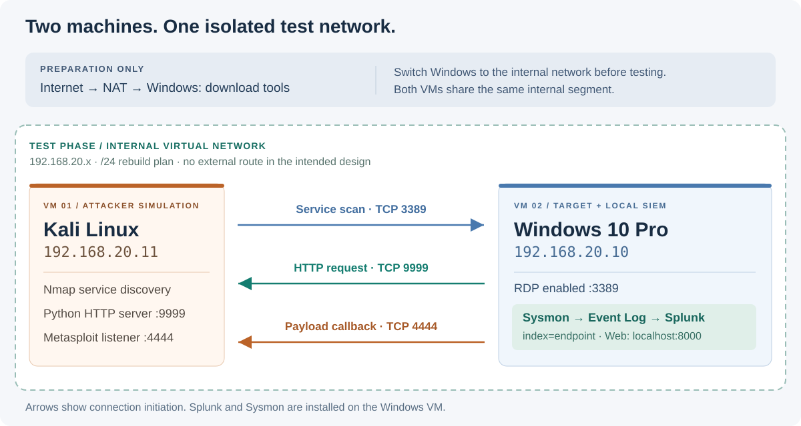

# Architecture notes

[Back to the project](../README.md)

The current diagram follows the lab author's account and the observable addresses: Kali at 192.168.20.11, Windows at 192.168.20.10, and Splunk running locally on Windows. NAT belongs to the download/preparation phase. The internal network belongs to the testing phase.

The /24 prefix is the documented rebuild setting. Screenshots confirm the two host addresses but do not show the original subnet mask, every adapter setting, or routing table. The diagram describes the intended isolation; it is not an independent verification of it.

## Supplied draft diagram

[network-diagram.png](network-diagram.png) is preserved as the original conceptual image. It depicts a separate Splunk VM, an Internet/NAT path into the lab, and Kali log forwarding. Those details are not the two-VM build described here, so it is not used as the portfolio's topology.

The two SVG files are editable, local assets with no external fonts, scripts, or remote image dependencies.
